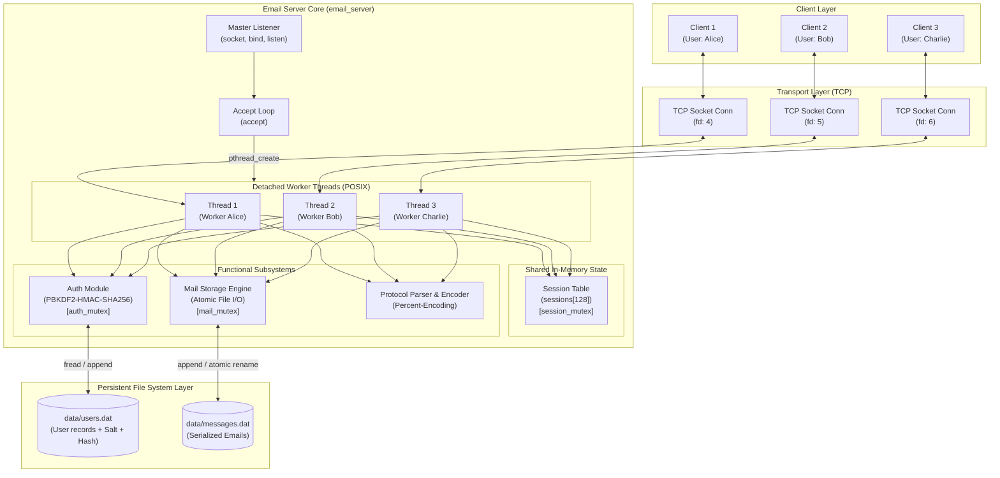
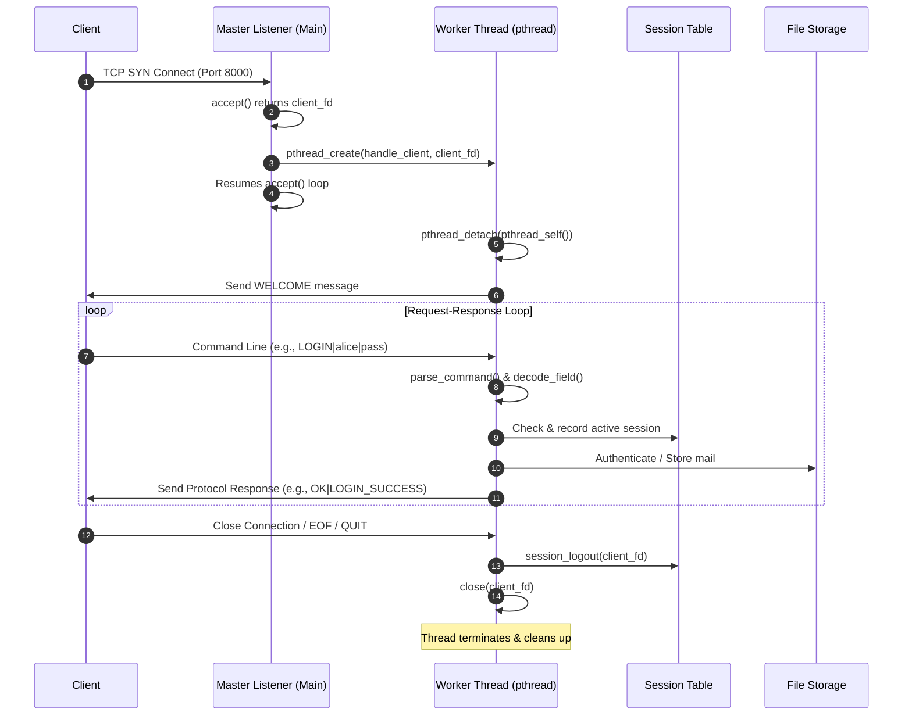
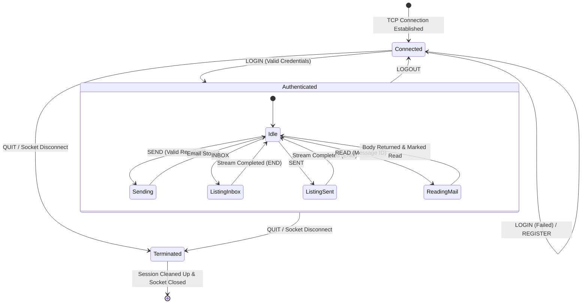
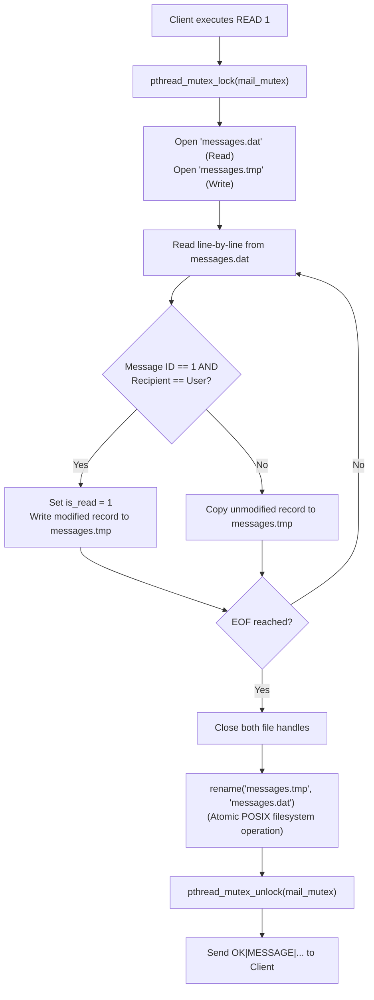

# System Architecture & Technical Specification

This document provides a comprehensive technical breakdown of the multi-client email server architecture, network communication protocol, concurrency models, thread synchronization, and data persistence layer.

---

## 1. High-Level Architectural Model

The system follows a classic **Centralized Client-Server Architecture** operating over the **TCP/IP transport layer**. The server process operates as a long-running daemon that listens on a designated TCP port, dynamically accepting incoming client connections and offloading their servicing to isolated worker threads.



---

## 2. Multi-Threaded Concurrency Model

### 2.1 Thread-per-Client Pattern
- When the master listener thread executes `accept()`, a new connected socket file descriptor (`client_fd`) is returned.
- A dynamically allocated heap structure `ClientArg` containing `socket_fd` is passed to `pthread_create()`.
- The worker thread immediately invokes `pthread_detach(pthread_self())`. This ensures that upon client exit or socket error, the thread terminates and its resources (stack, descriptors, TLS) are automatically reclaimed by the kernel without requiring `pthread_join()`.
- The main thread returns immediately to `accept()`, achieving non-blocking responsiveness for subsequent connection requests.



### 2.2 Concurrency Rationale
Compared to alternative concurrency strategies:
- **`fork()` Multi-Process:** Creating a process per client requires heavy virtual memory overhead and copy-on-write page table duplication. More importantly, inter-process synchronization (e.g., sharing the active session table to detect whether a user is already logged in on another terminal) would require System V / POSIX shared memory (`shmget`/`mmap`) and named semaphores.
- **`select()` / `poll()` / `epoll()` Event Loops:** While extremely scalable for high C10K workloads, an asynchronous I/O multiplexer requires converting synchronous workflows (password hashing with 210,000 iterations, disk file I/O) into non-blocking event-driven state machines or thread pools.
- **`pthread` Threads (Selected):** Striking the optimal balance for an educational mail system, threads share the process address space—making global synchronization via mutexes straightforward—while remaining lightweight and responsive.

---

## 3. Protocol State Machine

The client connection transitions through distinct states governed by authentication and session tracking:



---

## 4. Message Framing & Delimiter Handling

### 4.1 The Delimiter Collision Challenge
In naive text-based protocols (e.g., using `|` as a field separator), if a user sends an email containing the text:
```
Meet me at 5|6 PM.
```
A naive parser would split on `|`, incorrectly treating `6 PM.` as an extra field and causing protocol framing desynchronization.

### 4.2 Percent-Encoding Solution
To eliminate delimiter collision and protocol injection vulnerabilities, both client and server implement symmetric **percent-encoding** before data is placed on the network wire:

| Character | ASCII Hex | Encoded String | Description |
| :---: | :---: | :---: | :--- |
| `%` | `0x25` | `%25` | Escape character itself |
| `\|` | `0x7C` | `%7C` | Protocol and storage field delimiter |
| `\n` | `0x0A` | `%0A` | Line termination character |
| `\r` | `0x0D` | `%0D` | Carriage return |

- **Transmission:** `encode_protocol_field()` maps every occurrence of reserved characters into a 3-character `%HH` sequence.
- **Reception:** `decode_field()` parses `%HH` back into its original single-byte representation.
- **Security Check:** Literal NUL bytes (`\0`) inside percent-encoded streams are rejected, protecting against C string truncation exploits.

---

## 5. Synchronization & Mutual Exclusion (Mutex Design)

The system enforces fine-grained locking through three dedicated, non-recursive POSIX mutexes:

```mermaid
classDiagram
    class AuthSubsystem {
        -pthread_mutex_t auth_mutex
        +register_user()
        +authenticate_user()
        +auth_user_exists()
    }

    class SessionSubsystem {
        -pthread_mutex_t session_mutex
        -Session sessions[128]
        +session_login()
        +session_logout()
        +session_get_username()
    }

    class MailSubsystem {
        -pthread_mutex_t mail_mutex
        +mail_send()
        +mail_get_inbox()
        +mail_get_sent()
        +mail_read_message()
    }

    AuthSubsystem --> "data/users.dat" : Serialized Read/Write
    SessionSubsystem --> "sessions array" : In-Memory Atomic Updates
    MailSubsystem --> "data/messages.dat" : Atomic Tempfile & Rename
```

### 5.1 Lock Granularity & Deadlock Avoidance
- **`auth_mutex`:** Held strictly while opening, scanning, or appending to `data/users.dat`.
- **`session_mutex`:** Held strictly while reading or modifying `sessions[MAX_SESSIONS]`.
- **`mail_mutex`:** Held strictly during mail store and retrieve operations on `data/messages.dat`.
- **Zero Lock Nesting:** Threads **never acquire more than one mutex simultaneously**. For instance, during `handle_send()`, the thread queries `session_get_username()` (acquires and releases `session_mutex`), then queries `auth_user_exists()` (acquires and releases `auth_mutex`), and finally calls `mail_send()` (acquires and releases `mail_mutex`). Because locks are never nested, **deadlock is mathematically impossible**.

---

## 6. Data Storage & Atomic Updates

### 6.1 Flat-File Storage Architecture
To remain completely self-contained without requiring external database dependencies (e.g., MySQL, SQLite), storage uses structured flat files inside the `data/` directory.

#### `data/users.dat` Format:
```
username|email|salt_hex|hash_hex\n
```
- Passwords are encrypted using **PBKDF2-HMAC-SHA256**:
  $$\text{DerivedKey} = \text{PBKDF2}(\text{HMAC-SHA256}, \text{Password}, \text{Salt}, \text{Iterations}=210000, \text{KeyLen}=32)$$
- Random 16-byte salt is generated per user using OpenSSL's cryptographically secure PRNG `RAND_bytes()`.
- Hashes are verified using `CRYPTO_memcmp()` to thwart timing side-channel attacks.

#### `data/messages.dat` Format:
```
id|timestamp|sender|recipient|is_read|subject|body\n
```
- `id`: Monotonically increasing 64-bit integer (`unsigned long long`).
- `timestamp`: 64-bit Unix epoch integer (`time_t`).
- `is_read`: Boolean status (`0` = unread, `1` = read).

### 6.2 Atomic Read-Status Update Workflow
When a client reads an email, the message's `is_read` flag must change from `0` to `1`. In-place updates in variable-length text files risk data corruption if the process crashes mid-write. The implementation solves this using **atomic file swapping**:


Because POSIX `rename()` is guaranteed to be atomic by the OS kernel, the database is never left in a partially written state even if a power failure occurs.

---

## 7. Socket I/O & Network Robustness

### 7.1 Stream Framing with `recv_line()`
TCP provides a byte stream, not a datagram stream. A single `recv()` call may return partial lines or multiple concatenated lines. The helper `recv_line()` reads single bytes until `\n` is encountered, assembling messages cleanly up to buffer capacity and preventing framing desynchronization.

### 7.2 Broken Pipe Resilience (`SIGPIPE`)
If a client crashes or abruptly drops connection while the server is writing back a response:
- In `server/server.c`: `send()` is invoked with `MSG_NOSIGNAL` flag, suppressing `SIGPIPE` and returning `-1` with `errno == EPIPE`.
- In `client/client.c`: `signal(SIGPIPE, SIG_IGN)` is explicitly configured during initialization.
- This ensures neither the server process nor client crashes due to network disconnection.
